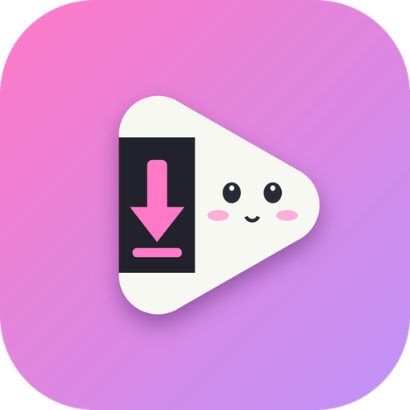
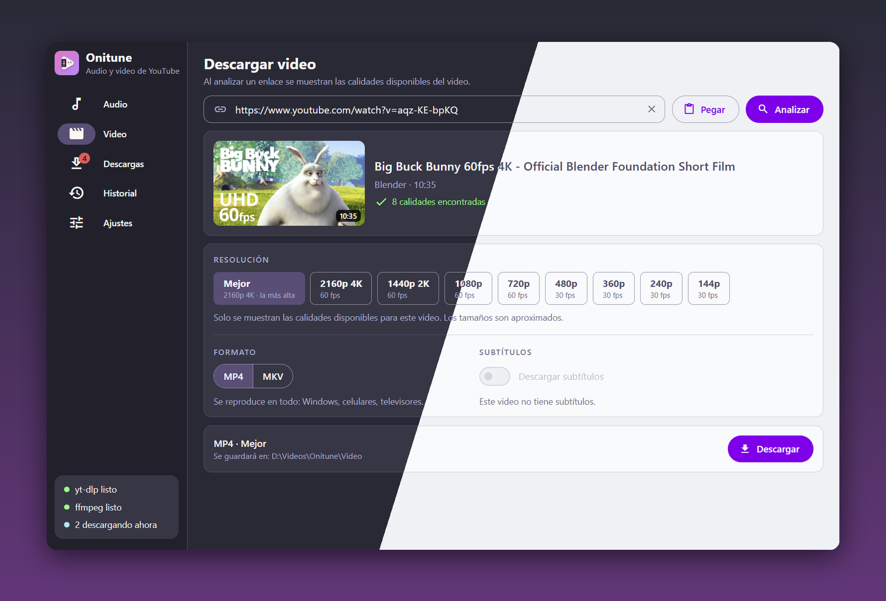
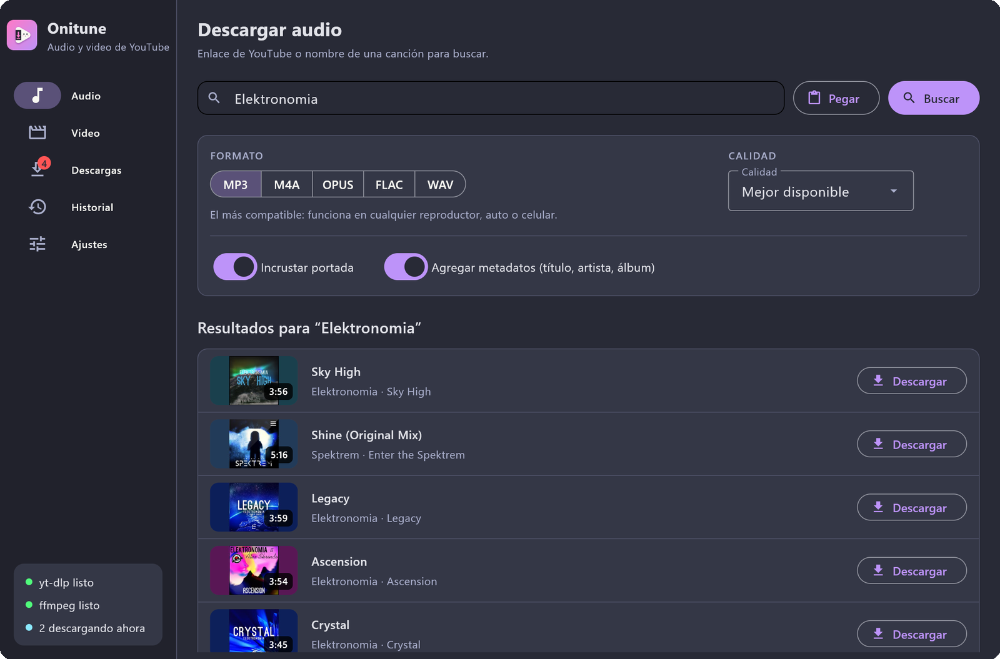
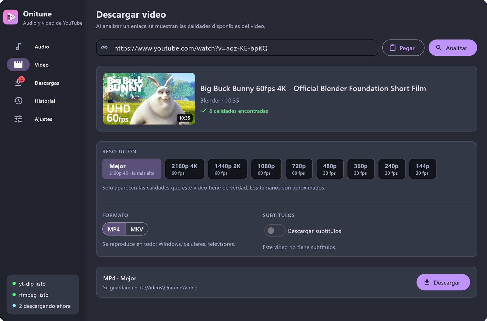
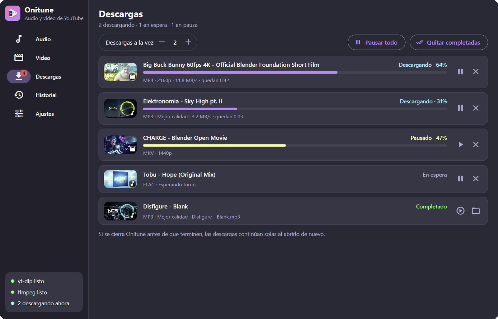
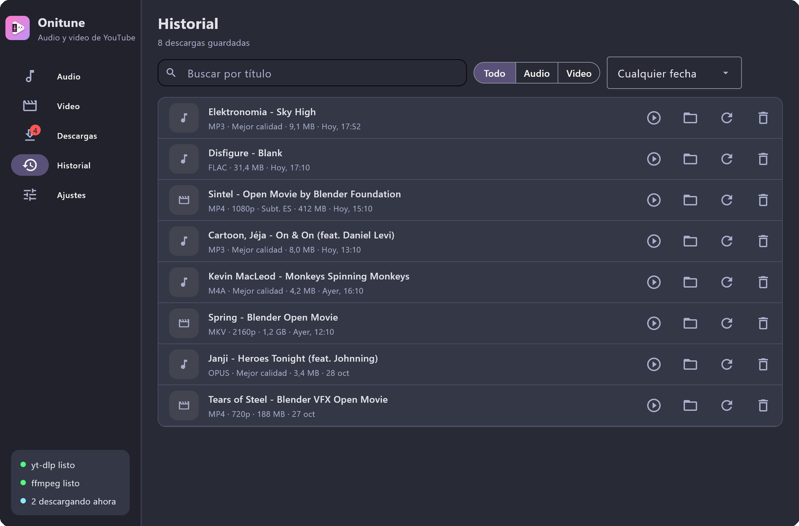
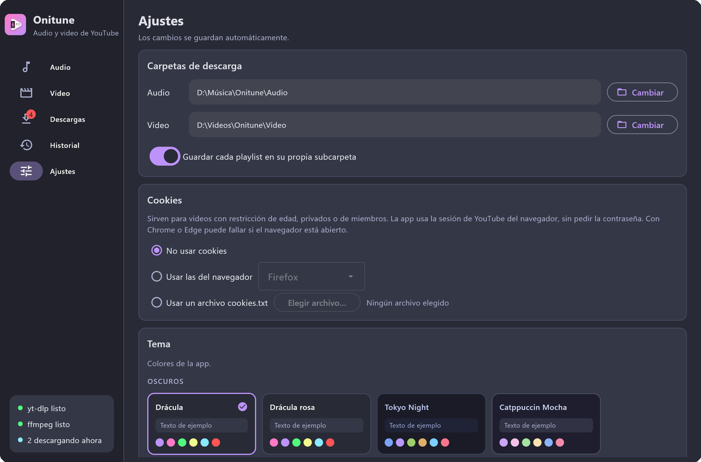
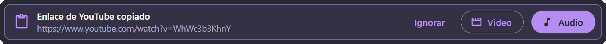
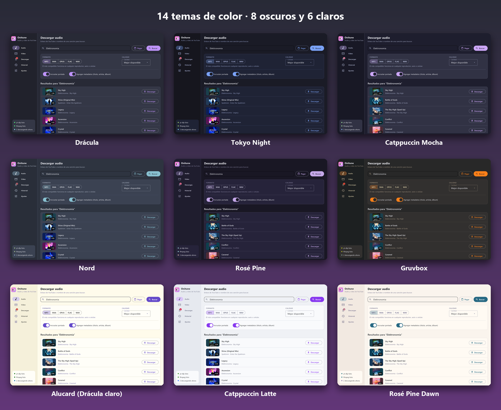

<p align="center"></p>

<h1 align="center">Onitune</h1>

<p align="center">
  <b>Descarga música y video de YouTube con una app bonita, simple y gratis.</b><br>
  MP3 o FLAC con portada y artista correctos · Video hasta 4K · 14 temas de color · Sin anuncios
</p>

<p align="center">
  <a href="https://github.com/angelqqi/Onitune/releases/latest"></a>
  <a href="https://github.com/angelqqi/Onitune/releases"></a>
  
  <a href="LICENSE"></a>
</p>

<p align="center">
  <a href="https://github.com/angelqqi/Onitune/releases/latest"><b>⬇️ Descargar para Windows</b></a>
  &nbsp;·&nbsp; sin instalar Python · sin permisos de administrador<br>
  <a href="README.md">Read in English</a>
</p>

<p align="center"></p>

## Qué hace

- **Audio:** MP3, M4A, OPUS, FLAC o WAV, con portada y metadatos. Se pega un enlace o se busca por nombre.
- **Búsqueda en YouTube Music:** las canciones quedan con artista y álbum correctos, y con portada cuadrada como en YouTube Music.
- **Video:** muestra solo las calidades que tiene cada video (hasta 4K y 60 fps). MP4 o MKV, con subtítulos.
- **Playlists:** se elige qué videos descargar.
- **Descargas:** varias a la vez; pausar, reanudar, cancelar o reintentar. Si se cierra la app, siguen al abrirla.
- **Historial:** buscar, abrir el archivo o la carpeta, volver a descargar o borrarlo todo.
- **Idiomas:** español, inglés y portugués. Por defecto usa el idioma del sistema (inglés si el tuyo aún no está traducido); se cambia en Ajustes.
- **Extras:** 14 temas (Drácula, Tokyo Night, Catppuccin, Nord, Gruvbox, Rosé Pine…), aviso al copiar un enlace de YouTube, cookies del navegador para videos con restricción de edad y aviso de versión nueva.

<details>
<summary><b>📸 Capturas</b></summary>
<br>

| Buscar música por nombre | Elegir la calidad del video |
|---|---|
|  |  |
| **Varias descargas a la vez** | **Historial** |
|  |  |
| **Ajustes** | **Aviso de enlace copiado** |
|  |  |

**14 temas de color**



Las capturas usan contenido de licencia libre: películas abiertas de [Blender](https://studio.blender.org/films/) y música de [NoCopyrightSounds](https://ncs.io).

</details>

## Descargar

En la [última versión (Releases)](https://github.com/angelqqi/Onitune/releases/latest). Ninguna necesita Python ni permisos de administrador:

| Archivo | Qué es |
|---|---|
| `Onitune-Setup-X.Y.Z.exe` | **Instalador** (recomendado): crea el acceso en el Menú Inicio y se desinstala desde la configuración de Windows. |
| `Onitune-X.Y.Z-windows.zip` | **Portable**: se descomprime la carpeta y se abre `Onitune.exe`. Es la que abre más rápido. |
| `Onitune.exe` | **Un solo archivo**: se abre sin instalar, pero tarda un poco más en abrir. |

La primera vez, la app descarga sola **yt-dlp**, **ffmpeg** y **Deno** (el motor de JavaScript que yt-dlp necesita para YouTube) de sus páginas oficiales, y comprueba la huella SHA256 de cada archivo.

**Linux (Debian, Ubuntu, Mint...):** descarga `onitune_X.Y.Z_all.deb` e instálalo con `sudo apt install ./onitune_X.Y.Z_all.deb` (apt agrega lo que haga falta). Luego abre Onitune desde el menú de aplicaciones o escribiendo `onitune`. En otras distribuciones, se puede usar con Python (ver abajo).

### ¿Sale "Windows protegió su PC"?

Windows muestra ese aviso con los programas que no están firmados digitalmente, algo común en proyectos pequeños y gratis. Para abrir Onitune: **Más información → Ejecutar de todas formas**.

Algunos antivirus también marcan por error los programas hechos con PyInstaller. Onitune es de código abierto, así que se puede:
- comprobar el archivo con las huellas SHA256 de `SHA256SUMS.txt` (también están en las notas de cada Release),
- revisar el código o crear el ejecutable uno mismo (ver abajo),
- y si un antivirus lo marca, [avisar en Issues](https://github.com/angelqqi/Onitune/issues) para reportarlo como falso positivo.

## Usar con Python

| | Windows | Linux |
|---|---|---|
| Con Python 3.13 | Doble clic en `Onitune.bat` | `./Onitune.sh` |

Los lanzadores actualizan el código (`git pull`), crean un `.venv` la primera vez, instalan `requirements.txt` y abren la app.

La ventana usa el navegador del sistema: en Windows, Edge WebView2 (ya viene con Windows 10 y 11). En Linux necesita GTK y WebKit; en Ubuntu/Debian: `sudo apt install python3-venv python3-gi gir1.2-webkit2-4.1`. Probado en Ubuntu 26.04 con su Python 3.14.

<details>
<summary><b>🌍 Agregar un idioma</b></summary>
<br>

Para agregar un idioma basta con traducir un archivo, sin tocar código:

1. Copiar `onitune/idiomas/es.json` y ponerle el código del idioma, por ejemplo `fr.json`.
2. Traducir los textos de la derecha. Se dejan igual: las claves de la izquierda, las palabras entre llaves (`{n}`, `{text}`…) y los nombres `"one"` / `"other"` (singular y plural).
3. Poner en `_name` el nombre del idioma en ese idioma (`Français`) y en `_decimal` su separador decimal.
4. Abrir la app, elegir el idioma en **Ajustes → Idioma** y revisar cómo se ve. Los textos que falten salen en español.

Después se puede enviar como pull request, o adjuntar el archivo en un [issue](https://github.com/angelqqi/Onitune/issues).

</details>

<details>
<summary><b>Para desarrolladores</b>: crear el ejecutable, carpetas y código</summary>

### Crear el ejecutable

```bash
.venv\Scripts\python -m pip install -r requirements-build.txt   # Windows
winget install JRSoftware.InnoSetup                              # solo para el instalador
python build.py
```

Todo queda en `dist/`: el instalador, el `.zip` portable, el `.exe` de un solo archivo y `SHA256SUMS.txt`. yt-dlp **no** va dentro a propósito: se actualiza solo y no hay que volver a crear el ejecutable cada vez que YouTube cambia algo.

### Dónde guarda las cosas

| Qué | Windows | Linux |
|---|---|---|
| Ajustes, descargas pendientes, historial, yt-dlp, ffmpeg y Deno | `%LOCALAPPDATA%\Onitune` | `~/.local/share/onitune` |
| Archivos descargados (por defecto, se cambia en Ajustes) | `Música\Onitune\Audio` y `Videos\Onitune\Video` | `~/Music/Onitune/...` y `~/Videos/Onitune/...` |

### Cómo está organizado el código

```
main.py                 Punto de entrada: abre la ventana
onitune/
  core/                 La lógica, sin nada de interfaz
    paths.py            Dónde se guarda cada cosa
    settings.py         Ajustes (settings.json)
    deps.py             Descarga yt-dlp, ffmpeg y Deno (comprueba sus huellas)
    ytdlp.py            Habla con yt-dlp: buscar, analizar y armar el comando de descarga
    queue.py            La cola de descargas: lanza yt-dlp, lee el progreso, pausa y cancela
    history.py          Historial (history.json)
    updates.py          Revisa en GitHub si hay una versión nueva de Onitune
    notify.py           Avisos de Windows/Linux
    proc.py             Ejecutar programas sin abrir consolas, abrir archivos y carpetas
    clipboard.py        Leer el portapapeles (Windows y Linux)
    i18n.py             Carga los textos del idioma elegido
  idiomas/              Un archivo por idioma: es.json, en.json, pt.json
  ui/                   La interfaz: una página web mostrada con pywebview
    app.py              Abre la ventana y le avisa a la página de los cambios (cola, historial, avisos)
    api.py              Las funciones de Python que la página puede usar (buscar, analizar, descargar...)
    themes.py           Los temas de color (para agregar uno, se suma a la lista)
    web/                La página: index.html, style.css y app.js
tools/make_icon.py      Dibuja el icono (assets/icon.png, assets/icon.ico)
build.py                Crea el ejecutable
```

`core/` no sabe nada de la interfaz y `ui/` no habla directamente con yt-dlp. Si YouTube cambia algo, normalmente basta con actualizar yt-dlp (botón en Ajustes). Las búsquedas y descargas corren en otros hilos; `ui/app.py` junta sus cambios y se los manda a la página en paquetes.

</details>

## Créditos

- **Idea, diseño y dirección:** [angelqqi](https://github.com/angelqqi).
- **Código:** escrito con ayuda de inteligencia artificial ([Claude](https://claude.com), de Anthropic), siguiendo las indicaciones y decisiones de angelqqi.

<details>
<summary>Nota del autor</summary>
<br>

Desarrollé Onitune en mi tiempo libre, por curiosidad: quería ver de qué es capaz la IA. No soy desarrollador de software y mis conocimientos de programación todavía son básicos; sin esa ayuda no habría podido hacer esta app por mi cuenta. Si algún programador encuentra alguna blasfemia en el código, pido disculpas de antemano.

No pienso dejar el proyecto de lado. El trabajo no me permite dedicarme de lleno, pero sigo aprendiendo de a poco y agregando funciones con ayuda de Claude. Cualquier comentario o consejo es bienvenido. Espero que les sea útil.

</details>

## Licencia y aviso legal

- El código de Onitune tiene licencia **MIT** (ver [LICENSE](LICENSE)). Los programas de terceros que usa (yt-dlp, FFmpeg, Deno, pywebview…) y sus licencias están en [THIRD_PARTY_LICENSES.md](THIRD_PARTY_LICENSES.md). yt-dlp, FFmpeg y Deno **no** van incluidos: la app los descarga de sus páginas oficiales.
- Onitune **no está afiliado** a YouTube ni a Google. "YouTube" es una marca de Google LLC y se menciona solo para describir para qué sirve la app.
- Descargar contenido puede ir contra los términos de YouTube o los derechos de autor de quien lo creó. **La app debe usarse solo con contenido que se tenga derecho a guardar** (por ejemplo, videos propios o contenido con licencia libre). Cada persona es responsable de cómo la usa.
