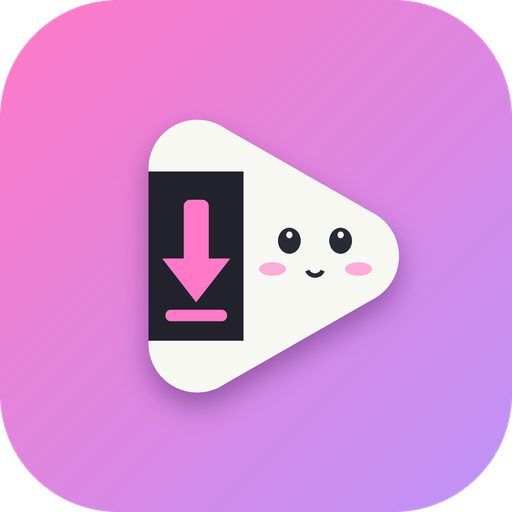
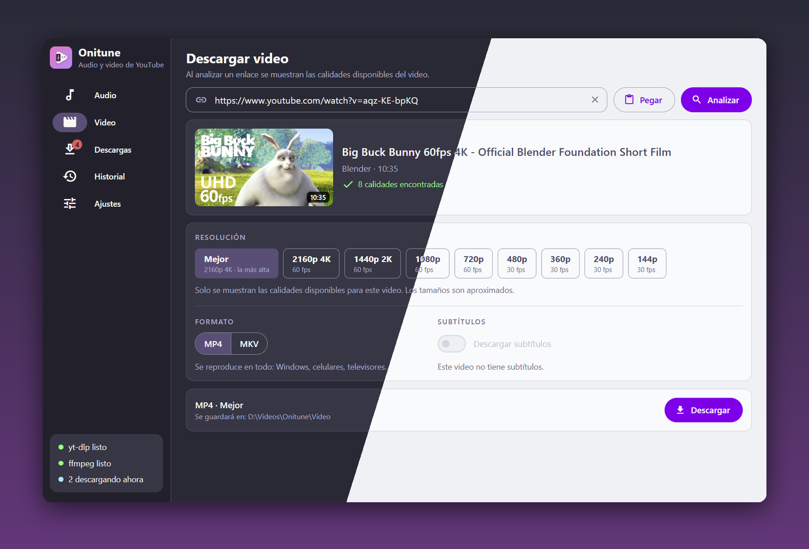
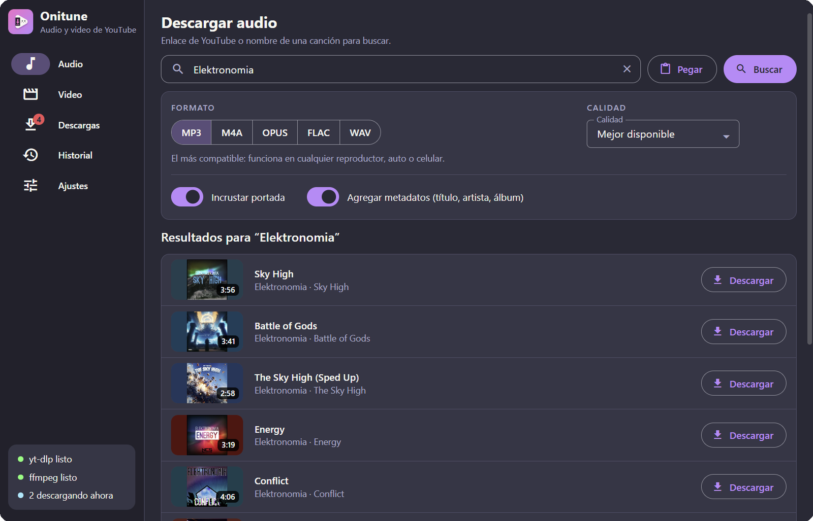
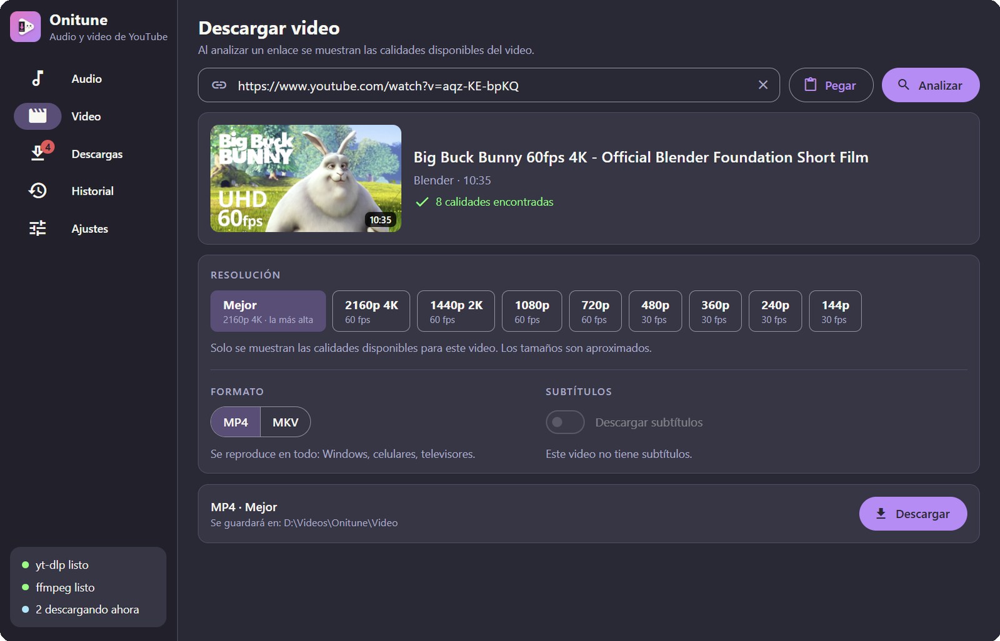
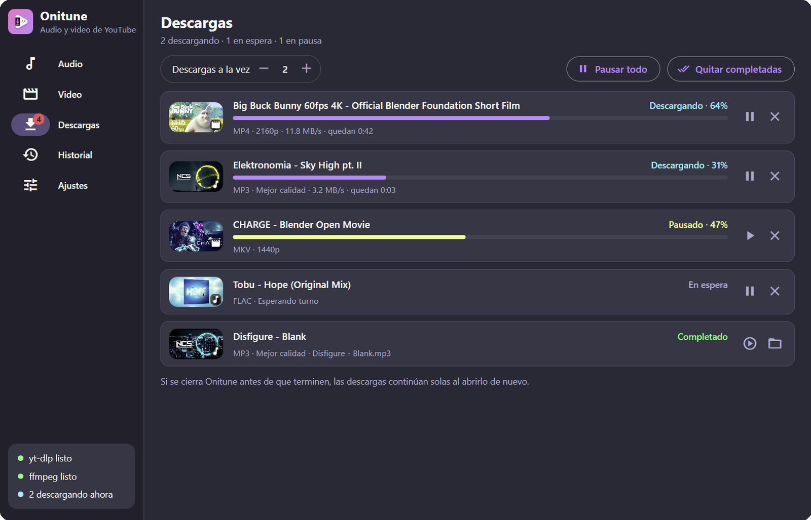
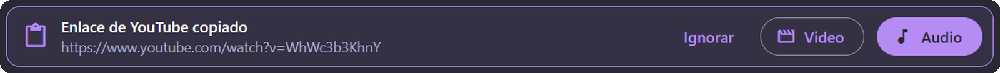
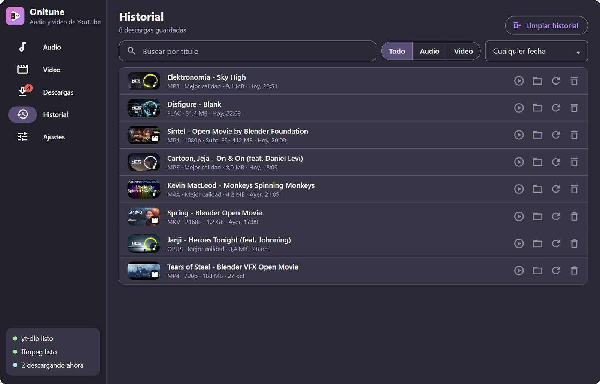
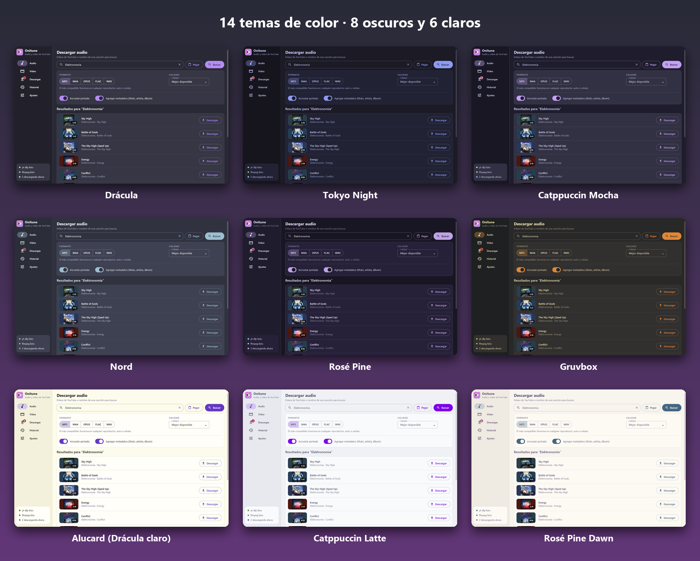
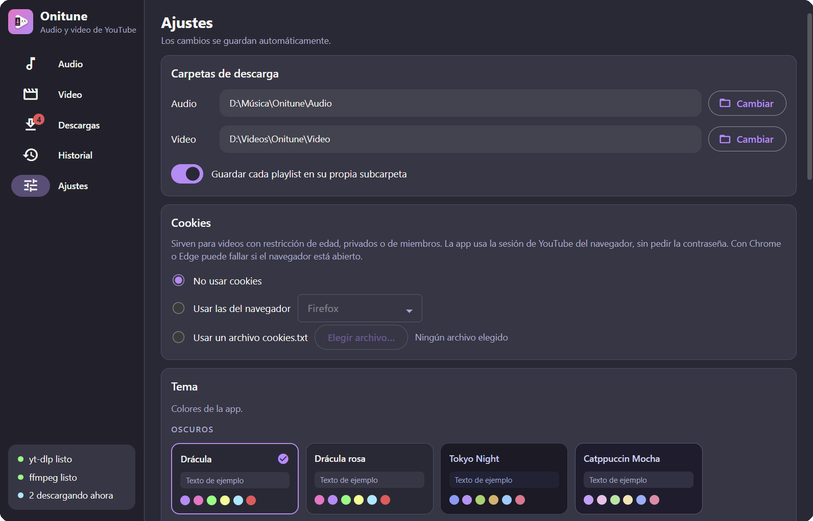
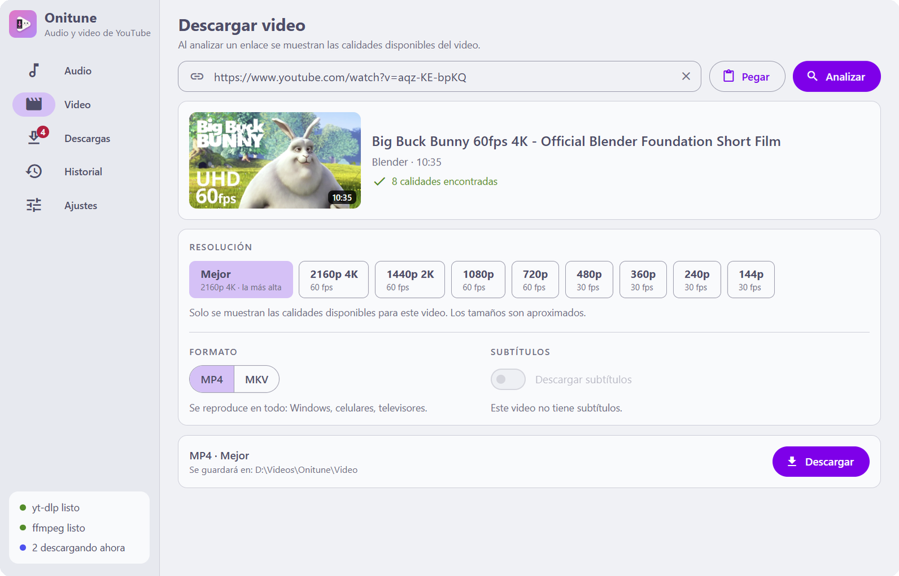

<p align="center"></p>

<h1 align="center">Onitune</h1>

<p align="center">
  <b>Descarga música y video de YouTube con una app bonita, simple y gratis.</b><br>
  MP3 o FLAC con portada y artista correctos · Video hasta 4K · 14 temas de color · Sin anuncios
</p>

<p align="center">
  <a href="https://github.com/angelqqi/Onitune/releases/latest"></a>
  <a href="https://github.com/angelqqi/Onitune/releases"></a>
  
  <a href="LICENSE"></a>
</p>

<p align="center">
  <a href="https://github.com/angelqqi/Onitune/releases/latest"><b>⬇️ Descargar para Windows</b></a>
  &nbsp;·&nbsp; sin instalar Python · sin permisos de administrador
</p>

<p align="center"></p>

## Qué hace

- **Audio:** MP3, M4A, OPUS, FLAC o WAV, con portada y metadatos. Se puede pegar un enlace o buscar por nombre y elegir entre los resultados.
- **Búsqueda en YouTube Music:** al buscar por nombre, busca canciones en YouTube Music para que el archivo quede con artista y álbum correctos. Se puede apagar en Ajustes.
- **Portada cuadrada:** recorta la miniatura de YouTube para que la portada quede cuadrada, como en YouTube Music. Se elige en Ajustes si se aplica a canciones de YouTube Music, a todo el audio, al video o a nada.
- **Video:** analiza el enlace y muestra solo las resoluciones que ese video tiene. MP4 o MKV, con subtítulos incrustados o en un archivo aparte.
- **Playlists:** muestra la lista para seleccionar qué videos descargar.
- **Descargas:** varias a la vez; cada una se puede pausar, reanudar, cancelar o reintentar. Si se cierra la app, continúan al abrirla de nuevo.
- **Historial:** buscar, filtrar, abrir el archivo o la carpeta, volver a descargar y borrar (de a uno o todo de una vez).
- **Temas:** 14 temas de color (Drácula, Alucard, Tokyo Night, Catppuccin, Nord, Gruvbox, Rosé Pine, Solarized…) que se eligen en Ajustes.
- **Extras:** detecta enlaces de YouTube copiados, usa cookies del navegador (para videos con restricción de edad), muestra avisos del sistema y avisa cuando hay una versión nueva de Onitune.

## Capturas

### Buscar música por nombre
Escribe un artista o una canción y elige entre los resultados de YouTube Music. El archivo queda con portada, artista y álbum.



### Video en la calidad que quieras
Al pegar un enlace, Onitune muestra solo las calidades disponibles para ese video (hasta 4K y 60 fps).



### Varias descargas a la vez
Cada descarga se puede pausar, reanudar o cancelar. Si se cierra Onitune antes de que terminen, continúan solas al abrirlo de nuevo.



### Copias un enlace y la app te avisa


### Historial
Busca lo que ya bajaste, ábrelo, abre su carpeta o vuelve a descargarlo.



### 14 temas de color


<details>
<summary>Más capturas (Ajustes, tema claro)</summary>





</details>

> Las capturas usan contenido de licencia libre: películas abiertas de [Blender](https://studio.blender.org/films/) y música de [NoCopyrightSounds](https://ncs.io).

## Créditos

- **Idea, diseño y dirección:** [angelqqi](https://github.com/angelqqi).
- **Código:** escrito con ayuda de inteligencia artificial ([Claude](https://claude.com), de Anthropic), siguiendo las indicaciones y decisiones de angelqqi.

## Licencia y aviso legal

- El código de Onitune tiene licencia **MIT** (ver [LICENSE](LICENSE)): se puede usar, modificar y compartir libremente, manteniendo el aviso de copyright.
- Los programas de terceros que usa (yt-dlp, FFmpeg, pywebview…) y sus licencias están en [THIRD_PARTY_LICENSES.md](THIRD_PARTY_LICENSES.md). yt-dlp y FFmpeg **no** van incluidos: la app los descarga de sus páginas oficiales.
- Onitune **no está afiliado** a YouTube ni a Google. "YouTube" es una marca de Google LLC y se menciona solo para describir para qué sirve la app.
- Descargar contenido puede ir contra los términos de YouTube o los derechos de autor de quien lo creó. **La app debe usarse solo con contenido que se tenga derecho a guardar** (por ejemplo, videos propios o contenido con licencia libre). Cada persona es responsable de cómo la usa.

## Descargar

En la [última versión (Releases)](https://github.com/angelqqi/Onitune/releases/latest) hay tres formas para Windows. Ninguna necesita Python ni permisos de administrador:

| Archivo | Para qué |
|---|---|
| `Onitune-Setup-X.Y.Z.exe` | **Instalador** (recomendado): crea el acceso en el Menú Inicio y se desinstala desde la configuración de Windows. |
| `Onitune-X.Y.Z-windows.zip` | **Portable**: se descomprime la carpeta y se abre `Onitune.exe`. Es la que abre más rápido. |
| `Onitune.exe` | **Un solo archivo**: se abre directamente, sin instalar. Tarda un poco más en abrir porque se descomprime cada vez. |

> Windows puede mostrar el aviso "Windows protegió su PC" porque el programa no está firmado. Para abrirlo: **Más información → Ejecutar de todas formas**.
>
> Las huellas SHA256 de todos los archivos están en `SHA256SUMS.txt` y en las notas de cada Release.
>
> **Linux:** el ejecutable para Linux llegará pronto. Mientras tanto, se puede usar con Python (ver abajo).

## Cómo abrirla

| | Windows | Linux |
|---|---|---|
| Con Python 3.13 | Doble clic en `Onitune.bat` | `./Onitune.sh` |
| Sin Python | [`Onitune.exe`](https://github.com/angelqqi/Onitune/releases/latest) | Próximamente |

La primera vez, la app descarga sola **yt-dlp** y **ffmpeg** a su carpeta. No hay que instalar nada ni pedir permisos de administrador.

Los lanzadores (`Onitune.bat` / `Onitune.sh`) hacen esto:
1. `git pull` para traer la última versión del programa.
2. Crean un entorno de Python (`.venv`) la primera vez, con Python 3.13 si está instalado.
3. Instalan lo que hay en `requirements.txt`.
4. Abren la app.

> **¿Por qué Python 3.13?** Es la versión con la que se prueba la app. En Windows se puede tener 3.13 al lado de otra versión: `py install 3.13`.
>
> La ventana usa el navegador del sistema: en Windows, Edge WebView2 (ya viene con Windows 10 y 11). En Linux necesita GTK y WebKit; en Ubuntu/Debian: `sudo apt install python3-gi gir1.2-webkit2-4.1`.

## Crear el ejecutable

```bash
.venv\Scripts\python -m pip install -r requirements-build.txt   # Windows
winget install JRSoftware.InnoSetup                              # solo para el instalador
python build.py
```

El resultado queda en `dist/`: el instalador, el `.zip` portable, el `.exe` de un solo archivo y `SHA256SUMS.txt`. Nada de eso necesita Python. yt-dlp **no** va dentro a propósito: así se actualiza solo y no hay que volver a crear el ejecutable cada vez que YouTube cambia algo.

## Dónde guarda las cosas

| Qué | Windows | Linux |
|---|---|---|
| Ajustes, descargas pendientes, historial, yt-dlp y ffmpeg | `%LOCALAPPDATA%\Onitune` | `~/.local/share/onitune` |
| Archivos descargados (por defecto) | `Música\Onitune\Audio` y `Videos\Onitune\Video` | `~/Music/Onitune/...` y `~/Videos/Onitune/...` |

Las carpetas de descarga se pueden cambiar en **Ajustes**.

## Cómo está organizado el código

```
main.py                 Punto de entrada: abre la ventana
onitune/
  core/                 La lógica, sin nada de interfaz
    paths.py            Dónde se guarda cada cosa
    settings.py         Ajustes (settings.json)
    deps.py             Descarga y actualiza yt-dlp y ffmpeg
    ytdlp.py            Habla con yt-dlp: buscar, analizar y armar el comando de descarga
    queue.py            La cola de descargas: lanza yt-dlp, lee el progreso, pausa y cancela
    history.py          Historial (history.json)
    updates.py          Revisa en GitHub si hay una versión nueva de Onitune
    notify.py           Avisos de Windows/Linux
    proc.py             Ejecutar programas sin abrir consolas, abrir archivos y carpetas
    clipboard.py        Leer el portapapeles (Windows y Linux)
  ui/                   La interfaz: una página web mostrada con pywebview
    app.py              Abre la ventana y le avisa a la página de los cambios (cola, historial, avisos)
    api.py              Las funciones de Python que la página puede usar (buscar, analizar, descargar...)
    themes.py           Los temas de color (para agregar uno, se suma a la lista)
    web/                La página: index.html, style.css (diseño) y app.js (pestañas, diálogos, avisos)
      fonts/            Iconos de Material
tools/make_icon.py      Dibuja el icono (assets/icon.png, assets/icon.ico)
build.py                Crea el ejecutable
```

**Idea clave:** `core/` no sabe nada de la interfaz y `ui/` no habla directamente con yt-dlp. Si YouTube cambia algo, normalmente basta con actualizar yt-dlp (botón en Ajustes). Para cambiar cómo se ve algo, basta con tocar `ui/`.

**Hilos:** las búsquedas y descargas corren en otros hilos para que la ventana no se congele. Cuando uno de esos hilos quiere cambiar algo en pantalla, usa `ui_call(page, funcion)` (en `ui/common.py`), que pasa el cambio al hilo de la interfaz.
